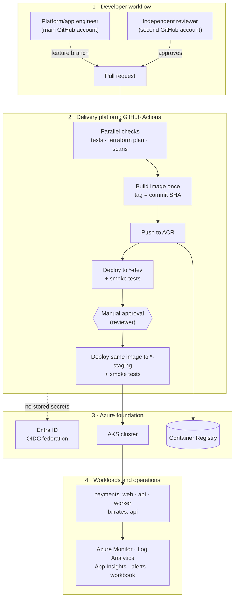
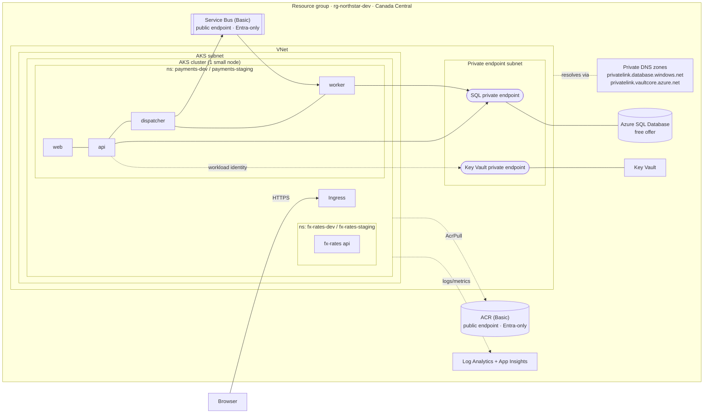
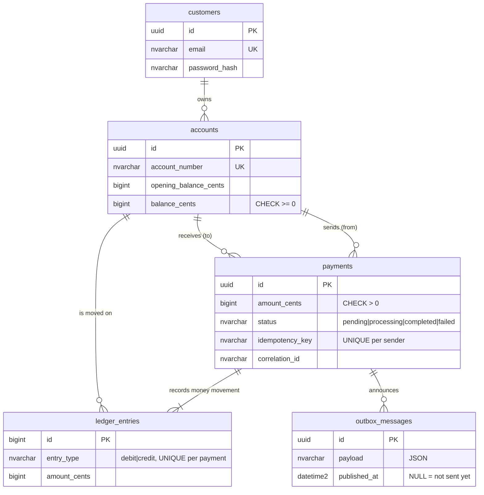
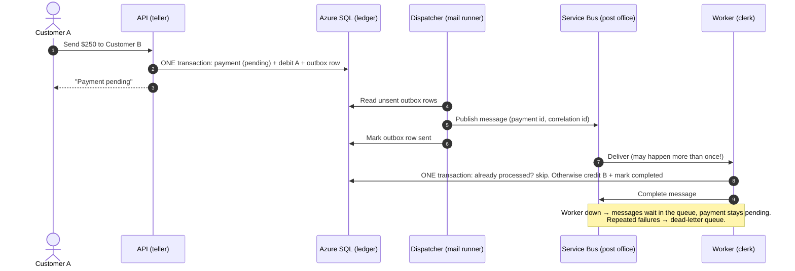

# Architecture

> Living document. Diagrams use Mermaid, which GitHub renders automatically.

## 1. The four layers and the end-to-end journey

## 2. Azure foundation (budget version: ADR-0001, ADR-0004)

**Why SQL and Key Vault are private but Service Bus and ACR aren't:** private endpoints for Service Bus and ACR
need their Premium tiers (hundreds of USD per month). They stay on public endpoints that only accept Entra ID identities. See ADR-0001.

## 3. Three separate identities

| Identity | Who | How it authenticates | What it may do |
|---|---|---|---|
| CI/CD identity | GitHub Actions | OIDC federation (short-lived token, no stored secret) | Push to ACR, deploy to AKS, run Terraform |
| Workload identity | Pods (one per app) | AKS workload identity (federated with a Kubernetes service account) | Only that app's SQL database, queue and Key Vault secrets |
| Customer identity | Bank customers | App login (password hash in SQL, session token) | Only their own accounts and transactions |

A compromised pipeline can't read customer data. A compromised pod can't change infrastructure. A customer can't see another customer's account.

## 4. Payments data model

Money is stored as whole **cents** (`BIGINT`). Source: `apps/payments/backend/migrations/versions/`.

| Rule (enforced by the database) | Protects against |
|---|---|
| `ck_accounts_balance_non_negative` | Overdrafts, even if application code has a bug |
| `uq_payments_sender_idempotency_key` | **Double-click** creating two payments and two debits |
| `uq_ledger_entries_payment_entry_type` | **Duplicate Service Bus message** crediting twice |
| Reconciliation: `opening + credits − debits = balance` | Silent drift between the ledger and balances |

## 5. Payment flow (the reliability scenario)

